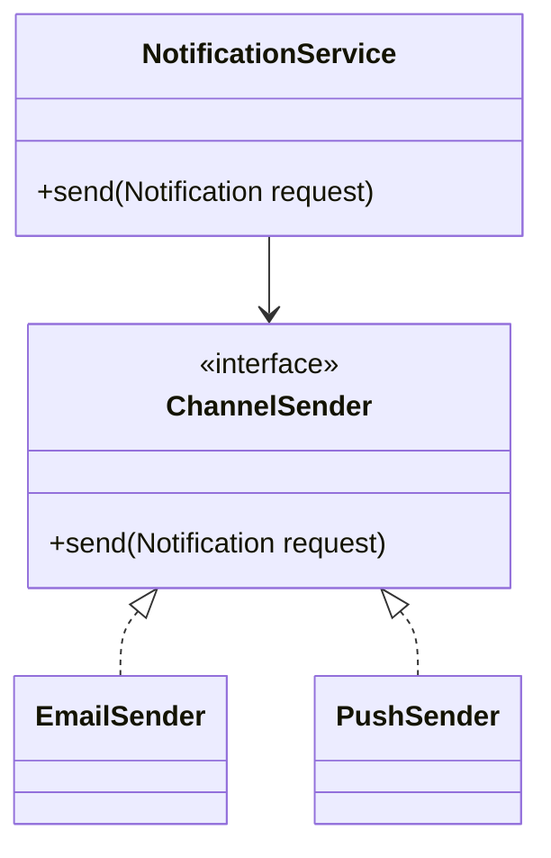

# Low-level design: show objects, invariants and extension points

## Interview sequence

1. Clarify actors and operations, constraints, thread safety, persistence and performance.
2. Identify domain entities and invariants, not class names first.
3. Sketch public interfaces and error handling contracts.
4. Walk one success scenario and one failure/concurrency scenario.
5. Show how another implementation is added without rewriting existing logic.
6. Discuss testing and observability.

## Example: extensible notification sender

Separate orchestration from channel-specific adapters. Dependencies should be injected, not constructed within business logic, so tests can use fakes.

## Concurrent seat booking thought experiment

A `Seat` entity and `BookingService` are not enough: define uniqueness of `(show_id, seat_id)` in the database and a transactional reservation strategy. An in-memory mutex on one server cannot prevent concurrent bookings across multiple instances.

## Follow-up questions

- Where does retry responsibility live?
- What if adding SMS as a new channel?
- Which invariants are enforced by DB constraints versus service code?
- How to unit-test failure recovery without calling real providers?
- How does the design change with multiple service instances?
