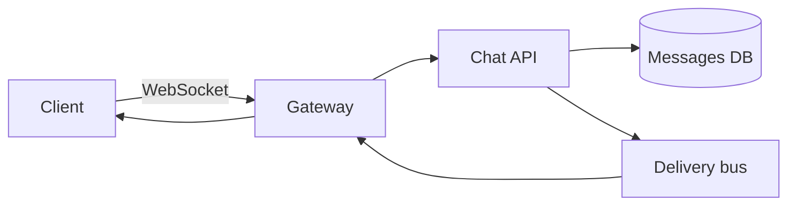

# Case study: design a chat system (1:1 and group)

## 1. Requirements

Send and receive text messages in 1:1 and group conversations with low latency. Clarify: message ordering guarantees, delivery receipts (sent/delivered/read), offline delivery, media attachments, presence/typing indicators, message history pagination, and end-to-end encryption expectations.

## 2. Assumptions (example only)

Suppose 10M daily active users, average 40 messages/user/day ⇒ 400M messages/day ≈ 4,600 average QPS. Peak factor 5 ⇒ ~23,000 send QPS. Average message 200 bytes ⇒ ~80 GB/day of message payload before replication and indexes; media is stored separately in object storage. Group chats amplify: one send fans out to N recipients.

## 3. APIs and realtime transport

```text
POST /v1/conversations/{id}/messages {"body":"...","clientMsgId":"uuid-..."}
  -> 201 {"messageId":"m_...","serverTs":...}
GET /v1/conversations/{id}/messages?before=m_...&limit=50
```

`clientMsgId` makes sends idempotent across retries. Realtime delivery over WebSockets (or long polling as fallback); the HTTP API handles history and sends. Sequence numbers per conversation give ordering without depending on wall-clock timestamps from clients.

## 4. Data model and flow

```text
messages(conversation_id, seq_no, message_id, sender_id, body, server_ts)
  PK (conversation_id, seq_no) -- ordering and pagination per conversation
```

Send flow: API validates → assigns `seq_no` (per-conversation sequencer or DB sequence) → persists → publishes to a per-recipient delivery channel → WebSocket gateways push to online devices; offline devices get the message on next history sync. Presence and typing indicators ride a separate lightweight channel so they never block message persistence.



## 5. Reliability

- **Ordering:** per-conversation `seq_no` assigned at write time; clients render by `seq_no`, not by arrival order.
- **Duplicates:** client-generated idempotency key + unique constraint; retries are safe.
- **Group fan-out:** one message → N deliveries; cap group size or shard large groups, and use async fan-out so a huge group can't block 1:1 sends.
- **Offline:** messages are durable in the DB; unread state is derived from per-user read cursors, not from push success.
- **Gateway failure:** stateless gateways behind a load balancer; connection state re-established on reconnect with a `since=seq_no` catch-up.

## 6. Follow-ups

- Hot conversation (viral group)? Shard delivery, rate-limit sends per conversation, read-path caching of recent messages.
- Read receipts at scale? Aggregate and batch them; don't write per-recipient-per-message receipt rows synchronously.
- Multi-device? Each device keeps its own read cursor and connection; sends are device-independent.
- E2E encryption? Server stores ciphertext only; search and abuse tooling move client-side.

**Tradeoff to say:** Per-conversation sequencing gives clean ordering but the sequencer is a contention point — shard it by conversation and accept that global cross-conversation ordering is not provided.
