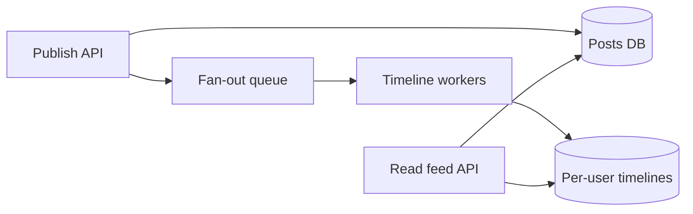

# Case study: social feed timeline

## Requirements and scale discussion

Users follow accounts, create posts, and read a ranked or chronological feed. Clarify follow graph cardinality, celebrity fan-out, freshness SLO, deletes, privacy, and consistency after posting.

## Architecture

## Compare approaches

- **Fan-out on write:** precompute followers' timelines. Fast reads, expensive celebrity writes, queue spikes and stale denormalized entries.
- **Fan-out on read:** join followed authors at read time. Simple writes, expensive reads for users following many accounts.
- **Hybrid:** normal authors precompute; celebrity posts merged on read. Additional read logic and tuning.

## Critical concerns

Use cursor pagination keyed by stable sequence/time+ID; don't trust client-supplied ranking values. Tombstone deleted/private posts and verify access at read path. Retries and duplicate fan-out require idempotency. Track publish-to-visible lag and feed cache hit rates.

**Follow-up:** If a post appears twice after a worker retry, where should dedupe happen and what is its key?
