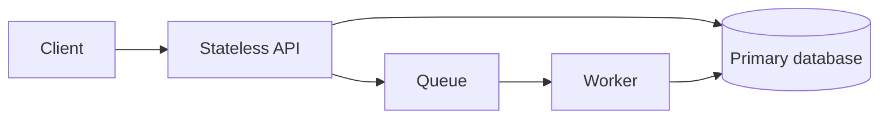

# The reusable system design framework (45-minute interview)

**Minute 0–5 · Clarify scope:** Who uses it? Top 2–3 user operations? What is out of scope? Availability, consistency, latency SLO, geographic/retention/security needs?

**Minute 5–8 · Estimate scale:** Daily requests, peak multiplier, object sizes, retention, traffic shape. Example: 8.64M requests/day ≈ 100 average QPS; ×5 peak ≈ 500 QPS. Clarify units and ratios instead of false precision.

**Minute 8–13 · API and data:** Define endpoints with request/response; main entities, relationships, identifiers, indexes, unique constraints and idempotency keys.

**Minute 13–23 · Simple working system:** Present request flow and source of truth before jumping to microservices. Discuss failures and strong/weak consistency expectations.

**Minute 23–35 · Deep dive on the hardest bottleneck:** caches, partitions, queues, hot keys, fan-out, conflict handling, or ordering. Justify technology based on the problem.

**Minute 35–42 · Reliability and operations:** retries, timeouts, dedup, disaster recovery, SLO monitoring and deployment. Cover authentication/authorization if relevant.

**Minute 42–45 · Summarize:** “We met requirements A/B; the key tradeoff is X vs Y; if traffic grows 10× I would first monitor Z.”

## Diagram starter

Add load balancing, caching, and replicas **only when the workload justifies them**. Show where authority and idempotency live.

## How to handle a challenging follow-up

1. Restate the invariant: “We can't lose paid orders” or “each user sees a consistent rollout assignment.”
2. Describe the current failure: e.g., a consumer crashes after side effect but before ack.
3. Offer mitigation and its tradeoff: idempotency key + durable dedupe, with storage overhead and lifecycle policy.
4. Define a test or metric: injected duplicate delivery; no duplicate side effects; failed-message count alert.
