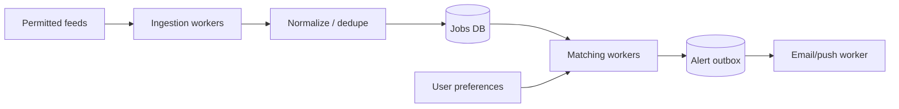

# Case study: job openings matching and alerts

An interview practice design for a **user-consented** alert product built from permitted APIs, RSS, or company feeds. Do not scrape sites in ways that violate terms or bypass access controls.

## Product requirements

Users subscribe to locations, levels and technologies; ingest postings; identify changes/duplicates; notify only for **new, relevant** jobs. Track expiration, false positives and alert fatigue.

## Architecture

## Design details

- Canonicalize source URL, company/req ID, title and location. Stable source IDs beat fuzzy matching when available.
- Maintain `first_seen_at` and `last_seen_at`; avoid treating an edited listing as new by default.
- Model user exclusions: title level, sponsorship requirement as *stated by source* (do not infer), location/hybrid, salary if available.
- Outbox + per-user per-job dedup key prevents most repeat alerts; handle provider retries.
- Observability: ingestion freshness, match false positives, delayed alerts, unsubscribes, duplicate suppression.

## Tradeoff

An exact rule matcher is explainable and cheap but misses semantic synonyms; embeddings/LLMs can boost recall but add cost, ambiguity and false positives. Consider showing match reasons and giving users controls.
