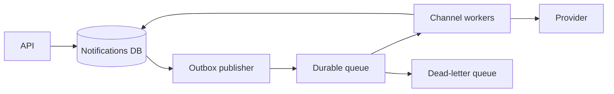

# Case study: reliable notification delivery

## Requirements

Send email, push, and in-app notifications; accept user preferences; handle spikes; respect provider rate limits. Clarify whether “send” means queued, accepted by vendor, or actually delivered (delivery acknowledgments vary).

## API & model

```text
POST /v1/notifications {idempotencyKey, userId, channel, templateId, variables}
notifications(id PK, user_id, channel, status, idempotency_key UNIQUE, created_at)
attempts(id PK, notification_id, provider, attempt, outcome, next_retry_at)
```

## Architecture



**Critical detail:** Accept + persist intent atomically with an outbox record if publication must not be lost. At-least-once queues can deliver duplicates; workers dedupe based on persisted provider-send identity as far as possible. Truly exactly-once provider delivery may not be achievable without provider support.

## Failure handling

- Worker crash after provider accepts but before DB acknowledgement: duplicate delivery risk; use provider idempotency when supported.
- Rate-limited provider: exponential backoff + jitter, capped retries and per-provider bulkhead.
- User opt-out: check preferences at scheduling and/or just before sending depending on policy.
- Poison message: record reason and route to DLQ for investigation.

## Metrics

Age of oldest queued message, send attempts, provider response distribution, time-to-delivery, DLQ rate, duplicate suppression count, and user-facing success.

**Design interview follow-up:** Would you use Kafka or SQS? State required ordering/retention/replay/operations rather than naming a favorite by habit.
