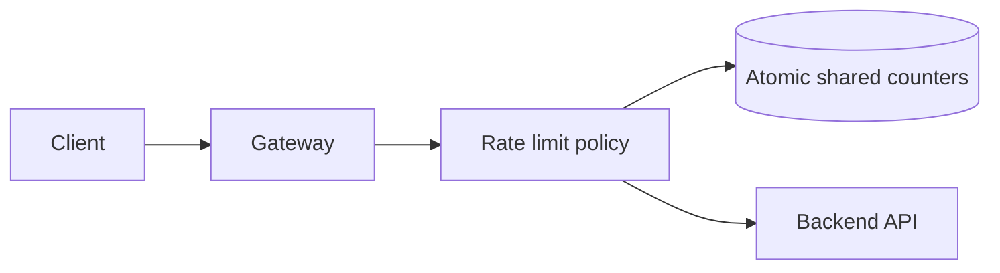

# Case study: distributed rate limiter

## Requirements

Limit requests by identity (user/API key/IP), with configurable policies; return 429 and Retry-After when appropriate. Clarify limits per second/day, regional distribution, fail-open/closed preference, and fairness.

## Token bucket

Each key has capacity `C`, refill rate `r` tokens/sec, remaining tokens, and last refill time. For request at `now`:

```text
available = min(C, previous + max(0, now-last) * r)
if available >= requested: allow; subtract requested
else: reject
```

A per-instance implementation protects local state with a lock; **distributed** exact enforcement needs a shared atomic operation (e.g., Redis Lua script), or deliberately permits approximate regional quotas.

## Architecture



## Tradeoffs

- Per-instance tokens: very fast but global over-admission possible with N instances.
- Central Redis: shared enforcement, but adds network hop and dependency. Define outage fallback.
- Fixed window: cheapest, bursty at window boundaries.
- Sliding log: precise but memory heavy.
- Token bucket: supports smooth average with controlled bursts.

## Observe

Allowed vs rejected, key cardinality, limiter latency, Redis errors, policy propagation delay, customer-specific incidents. Never record raw sensitive API keys in logs.

→ See [Java implementation of a local thread-safe token bucket](../src/main/java/dev/fieldguide/TokenBucket.java) (not a distributed limiter).
