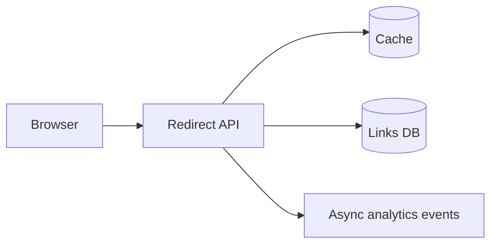

# Case study: design a URL shortener

## 1. Requirements

Generate short codes for long URLs; redirect quickly; optional custom aliases and expiration. Clarify analytics, abuse protection, slug uniqueness, read/write ratio, and required read-after-write guarantees.

## 2. Assumptions (example only)

Suppose 1M new links/day, 50M redirects/day, average 500 bytes metadata per link. New writes ≈ 12 QPS; redirects ≈ 579 average QPS. Peak factor 5 ⇒ ~2,900 redirect QPS. Storage of new metadata ≈ 500 MB/day before replicas/indexes.

## 3. APIs

```text
POST /v1/links {"url":"https://example.org/a","expiresAt":null}
  -> 201 {"code":"A1b2C3","shortUrl":"https://s.example/A1b2C3"}
GET /{code} -> 302 Location: originalUrl
```

Use 302 when tracking redirects or destinations may change; 301 only if permanently redirecting and accepting client caching.

## 4. Data model and flow

```text
links(code PK UNIQUE, destination_url, created_at, expires_at, owner_id)
```



Use random high-entropy code generation + collision retry/unique index, or distributed ID encoding when predictability is acceptable. Cache frequently accessed codes. Ensure invalid/expired links don't redirect.

## 5. Reliability

Handle cache stampedes, malicious destination validation and anti-abuse policy, redirects for expired links, and rate limits on creations. Analytics must not block redirects.

## 6. Follow-ups

- How avoid guessable sequential codes? Random identifiers and large space.
- Hot celebrity link? Cache + edge distribution.
- Redirects in many regions? Replicated cache/DB with propagation lag policy.
- Delete requirement? Reconcile cached copies, TTL and audit retention.

**Tradeoff to say:** Short codes vs collision risk vs storage; redirect latency vs cached staleness.
